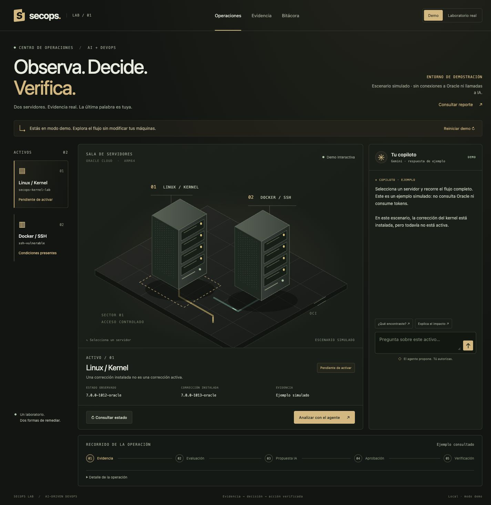
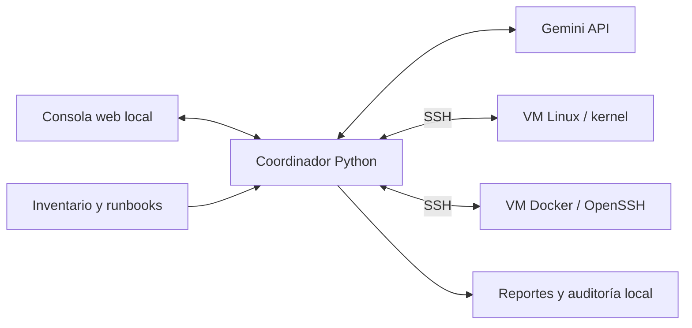

# SecOps Runbook Copilot

AI-assisted Linux and Docker remediation with Gemini, evidence-based runbooks, human approval, and audit trails.

Proyecto integrador de AI-Driven DevOps. Un coordinador Python recoge evidencia de dos casos de laboratorio, evalúa condiciones conocidas y solicita a Gemini una explicación y un procedimiento permitido. Una persona revisa y aprueba el procedimiento. El coordinador ejecuta el runbook y comprueba el resultado.



## Arquitectura



El recorrido incluye evidencia, evaluación, propuesta, validación de política, aprobación, ejecución y verificación. La consola muestra el estado y permite conversar con el copiloto.

## Probar la demo local

Requiere Python 3.10 o posterior.

```bash
git clone https://github.com/ContardoRM/secops-runbook-copilot.git
cd secops-runbook-copilot
python3 -m venv .venv
source .venv/bin/activate
python3 -m pip install -r requirements.txt
python3 console/server.py
```

Abrir [http://127.0.0.1:8765](http://127.0.0.1:8765) y seleccionar **Demo**. Este modo usa ejemplos identificados como simulación. Permite recorrer selección de activo, análisis, aprobación y verificación. Se puede utilizar sin configurar acceso a Oracle ni una clave de Gemini.

La consola escucha en `127.0.0.1`. Para detenerla, usar Control+C al terminar una operación.

## Casos implementados

| Caso | Evidencia | Procedimiento | Resultado esperado |
| --- | --- | --- | --- |
| OpenSSH sobre musl en Docker | Versión del binario, soporte PAM, configuración SSH y condiciones de cuentas | Deshabilitar autenticación por contraseña y reiniciar el contenedor | `password_authentication_mitigated` |
| Kernel Ubuntu para Oracle | Kernel activo y paquetes instalados | Activar el kernel corregido instalado y verificar un nuevo arranque | `fixed_kernel_active_for_lab_case` |

El caso Docker se basa en el aviso de Alpine del 5 de noviembre de 2026. El caso de kernel usa las versiones de laboratorio `7.0.0-1012-oracle` y `7.0.0-1013-oracle`, vinculadas a CVE-2026-92502. Las reglas y los ejecutores están acotados a estos escenarios.

## Configurar el laboratorio real

El modo real requiere dos VM Linux ARM64 preparadas, acceso SSH con los alias `vm1` y `vm2`, y permisos para los procedimientos administrativos del laboratorio. La infraestructura y las imágenes vulnerables se preparan por separado.

1. Copiar y adaptar el inventario de ejemplo.

```bash
cp inventory/assets.example.yaml inventory/assets.yaml
mkdir -p reports
```

2. Configurar los alias en el archivo SSH local. Las direcciones siguientes son ejemplos de documentación y deben reemplazarse.

```sshconfig
Host vm1
    HostName 192.0.2.10
    User ubuntu
    IdentityFile ~/.ssh/your_lab_key

Host vm2
    HostName 192.0.2.20
    User ubuntu
    IdentityFile ~/.ssh/your_lab_key
```

3. Instalar los recolectores en las VM ya preparadas.

```bash
ssh vm1 'mkdir -p ~/secops-lab/collectors ~/secops-lab/reports'
ssh vm2 'mkdir -p ~/secops-lab/collectors ~/secops-lab/reports'
scp remote/collectors/kernel_inventory.py vm1:secops-lab/collectors/
scp remote/collectors/docker_inventory.py remote/collectors/evaluate_ssh.py vm2:secops-lab/collectors/
```

VM2 debe disponer del contenedor `ssh-vulnerable` y del binario `/opt/openssh/sbin/sshd` definido por el escenario. VM1 debe tener los kernels del caso instalados. Revisar los runbooks y las precondiciones de los scripts antes de adaptar el proyecto a otro entorno.

4. Introducir la clave en la terminal del coordinador. Ejemplo para zsh en macOS.

```zsh
read -rs 'GEMINI_API_KEY?Clave de Gemini: '
echo
export GEMINI_API_KEY
export GEMINI_MODEL=gemini-3.1-flash-lite
python3 console/server.py
```

Seleccionar **Laboratorio real** y **Consultar estado**. Las operaciones de análisis y chat envían contexto técnico y evidencia a Google. La disponibilidad del modelo y la cuota dependen de la cuenta del proveedor.

## Uso desde la terminal

```bash
python3 coordinator.py status
python3 coordinator.py analyze --asset docker
python3 coordinator.py execute --asset docker
python3 coordinator.py analyze --asset kernel
python3 coordinator.py execute --asset kernel
```

Docker solicita `APROBAR`. Kernel solicita `APROBAR REINICIO` y programa una interrupción de la VM. Ejecutar una operación a la vez entre terminal y consola web.

`reset-demo.sh` reintroduce las condiciones de ambos casos y programa el reinicio de VM1. Está vinculado al identificador de imagen del laboratorio original. Para usarlo en otra instalación hay que revisar y adaptar esa comprobación. El botón **Reiniciar demo** de la web solo restaura la simulación.

## Evidencia y controles

- Los evaluadores de solo lectura determinan el estado técnico.
- Gemini explica y propone procedimientos permitidos.
- El coordinador valida activo, correspondencia de evidencia, antigüedad y política.
- La consola vincula la aprobación a los archivos de evidencia y plan mostrados.
- Los ejecutores guardan resultados y verifican el estado posterior.
- La auditoría histórica y el estado actual se proporcionan por separado al chat.
- Los archivos de credenciales, inventario real y reportes locales están excluidos de Git.

El indicador `action_executed: false` de un evaluador describe su propio comportamiento de solo lectura. Las ejecuciones se consultan en los archivos de auditoría.

## Pruebas locales

```bash
PYTHONDONTWRITEBYTECODE=1 python3 -m unittest discover -s console/tests -v
```

Las pruebas del adaptador cubren cancelación, aprobación de un solo uso, evidencia cambiada o antigua, restricción de acciones y la distinción entre auditoría y evaluación. Utilizan procesos locales de prueba.

## Estructura

```text
console/                 Interfaz local, servidor y ejemplos de demo
remote/collectors/       Recolectores para las VM
inventory/              Inventario de ejemplo
runbooks/               Procedimientos y criterios de verificación
coordinator.py          Entrada del flujo operativo
analyze*.py             Análisis mediante Gemini
execute*.py             Ejecución con aprobación
collect*.sh             Recolección por SSH
reset-demo.sh           Preparación del laboratorio original
```

## Alcance

Este prototipo trabaja con dos casos definidos. Docker demuestra una mitigación de configuración y mantiene pendiente el parche permanente de la imagen. Kernel verifica la activación de la corrección para el caso seleccionado. La recolección se realiza bajo demanda. Las verificaciones registradas cubren versiones y configuración, con explotación sin confirmar.

Los ejemplos incluidos en `console/demo` están marcados como simulación. El despliegue en modo real requiere completar la preparación del laboratorio. Los scripts individuales de terminal siguen accesibles fuera del control de la consola web.

## Referencias

- [Aviso de Alpine sobre OpenSSH y autenticación](https://alpinelinux.org/posts/2026-11-05-openssh-password-authentication-bypass/)
- [Ubuntu CVE-2026-92502](https://ubuntu.com/security/CVE-2026-92502)
